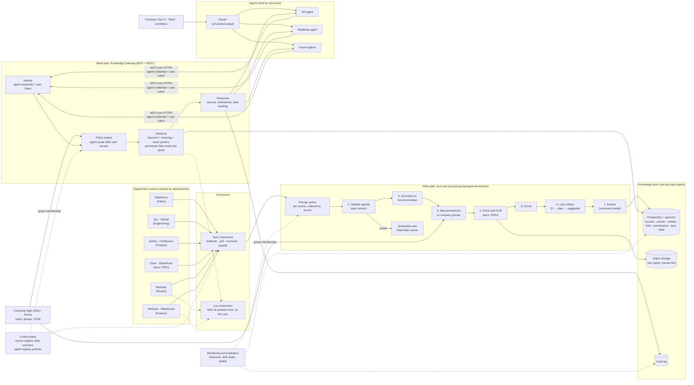
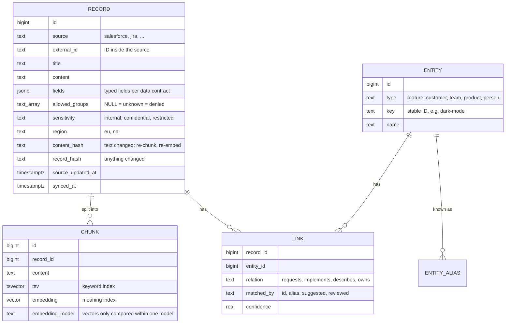
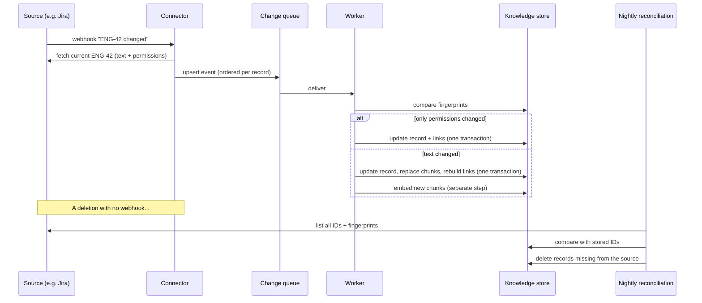

# Company Knowledge Layer for AI Agents: Production Design

**Author:** Feras Allaou · **Date:** 2026-11-05 · **Status:** proposal for discussion

A working proof of concept of this design is in this repository (see the [README](../README.md)). This document describes the **full production system** at the scale of a global company. Section 13 shows what the PoC proves and what it simplifies.

---

## 0. Summary

Agents need knowledge that is **accurate, current and authorized at the moment they act**. The system has two independent flows that meet only in a shared store:

- **Write path (self-maintaining):** department sources → connectors → a change queue → processing workers → the knowledge store. Additions, edits, deletions and **permission changes** flow through it continuously. A nightly full comparison catches anything that was missed.
- **Read path (safe access):** agents → one **Knowledge Gateway** (MCP + REST) → permission-filtered retrieval. Identity comes from verified credentials, never from the model. Access is allowed only when **both** the agent's scope **and** the user's own permissions allow it, and that check happens **inside the database query**.

Key decisions:

1. **Ingest by default, fetch live by exception.** Most knowledge is copied and indexed so it is fast, searchable and linkable. Highly sensitive or fast-changing data (salaries, leave balances, today's pipeline) is fetched from the source at question time, as the user.
2. **Three kinds of knowledge, three ways to query it.** Documents are searched by meaning and keywords. Records (deals, tickets) are queried exactly. Live data is fetched on demand. All three share one access layer and one permission model.
3. **A thin knowledge graph in PostgreSQL.** Records, chunks, entities and typed links live in PostgreSQL with pgvector, one cluster per data region. There is no separate vector or graph database until the scale demands one.
4. **Permissions are data, not prompts.** Each record stores who may see it. Permission changes are first-class updates with their own fast path, because **stale permissions are the main risk** of any copy-based design.
5. **Departments own their sources and data contracts.** The platform team owns the connectors' framework, the store and the gateway.

---

## 1. Assumptions: what we know and what we assume

The brief allows any reasonable assumption if it is stated. The assumptions below are the starting point for the discussion.

### Known (from the brief)

| # | Fact |
|---|---|
| K1 | Knowledge is spread across many systems, owned by different departments across the globe, in different shapes. |
| K2 | Sources change continuously and independently (create, edit, delete) with no central coordination and no common schema. |
| K3 | Agents will automate cross-department workflows (examples: an HR Q&A chatbot, a roadmap agent combining Sales, Engineering and Product). |
| K4 | Agents need knowledge that is accurate, current and authorized at the moment they act. Nothing provides this today. |
| K5 | The system must maintain itself without manual intervention. |

### Assumed (to be confirmed)

| # | Assumption | Why it matters |
|---|---|---|
| A1 | **Scale:** ~15,000 employees, ~40 departments, ~50 source systems, ~50M records and ~5M documents (~2 TB of text), ~1–2M changes per day. | Sizes the store, the queue and the embedding cost. Section 7 shows where the design changes if this is 10× larger. |
| A2 | **Regions:** at least the EU (ShopFully, Italy) and North America (Flipp, Canada), possibly APAC. Some data must stay in its region (GDPR, employee data). | Drives one store per region and regional model endpoints. |
| A3 | **Identity:** one company login (Okta or Microsoft Entra ID) with groups, synced to apps by SCIM. Every employee and every agent has an identity. | Permissions can be expressed as company groups. Without this, section 5 needs a per-source identity mapping. |
| A4 | **Typical sources:** Salesforce (Sales), Jira and GitHub (Engineering), Notion or Confluence (Product), Google Drive or SharePoint (documents and PDFs), Workday (People), NetSuite and a data warehouse (Finance). | Shapes the connector list in section 3. |
| A5 | **Load:** tens of agents, ~50–200 knowledge queries per second at peak, p95 retrieval latency under ~1 second. | Rules out live-only designs for most data. |
| A6 | **Freshness:** minutes for most sources, under 1 minute for permission removals, under 24 hours for anything that relies on the nightly comparison. | Defines the sync triggers and the monitoring targets. |
| A7 | **Agents are read-only** at first. Any action that changes a source system goes through that system's own API with explicit human confirmation, outside this layer. | Keeps the blast radius of a wrong or manipulated agent small. |
| A8 | Most sources expose **permissions we can read** (sharing settings, roles, groups). Some do not, such as PDFs on shared drives with loose folder rights. | Section 3.5 covers sources without reliable permissions. |

### Where I question the brief

- **"Knowledge base" is too narrow for some data.** A leave balance or a salary must not be copied into a shared store just so an agent can read it. The design treats **live access** as part of the knowledge layer, not an exception to it.
- **"Authorized at the moment they act"** cannot be fully guaranteed by any copy. A copy is only as fresh as its last permission update. I make this explicit: removals propagate fast (A6), the most sensitive sources are never copied, and a check can re-confirm with the source before something is returned (section 5.4).
- **"Without manual intervention"** applies to keeping data in sync. It should not apply to **ambiguous decisions**, such as whether two records describe the same customer. Those go to a review queue with a named owner (section 4.3).
- **Who owns knowledge quality?** The brief does not say. I assume each department owns its source's data contract and fixes its data, and the platform team owns the pipeline. This needs agreement, because a knowledge layer without owners decays.

---

## 2. Architecture

### 2.1 Components and data flow



### 2.2 How data flows, step by step

**Write path (a record changes in a source):**

1. The source sends a change notification, or a scheduled poll finds the change, or the nightly comparison finds a difference.
2. The connector fetches the full current item, **including its permissions**, and puts a change event on the queue. Events for the same record are kept in order.
3. Workers process the event:
   - **Validate** it against the source's data contract. Invalid items go to quarantine with an alert to the source owner. They never silently become knowledge.
   - **Normalize** it into the common record envelope: ID, title, text, typed fields, permissions, sensitivity, region, source timestamps.
   - **Map permissions** from the source's model (roles, sharing, folders) to company groups.
   - **Parse** documents (layout, tables, OCR for scans) and **chunk** them.
   - **Link** the record to shared entities (features, customers, teams).
   - **Embed** the chunks with the current embedding model.
4. Each record's change is applied **in one transaction**: row, chunks, links and permissions together. A reader never sees new text with old permissions. Embeddings are filled in by a separate step, so a model outage never blocks permission or text updates.

**Read path (an agent needs knowledge):**

1. The agent calls the gateway with **its own credential** and the **user's token** (it acts on the user's behalf).
2. The gateway verifies both. It lists only the tools this agent may use.
3. On each call, the gateway re-checks the grant and runs the query with the permission filter **inside** the query.
4. The results come back with their source, ID, last-update time and a data marking. The call is written to the audit log.
5. For live-only data, the gateway calls the source as the user (section 5.5).

### 2.3 Deployment shape

- **Two programs from one codebase:** the **gateway** (stateless, scaled horizontally, high availability) and the **workers** (sync and processing, scaled by queue depth). They share code and the store, but fail and scale independently. Later they can become separate services. In a NestJS monorepo, the shared types and clients would become libraries at that point.
- **One deployment per data region** (EU, NA, later APAC). The store, the workers and the gateway run in-region. A small **federation layer** in the gateway can fan a query out to several regions only where policy allows. By default, EU employee data is only queried in the EU.
- **The gateway is critical infrastructure.** Every agent depends on it, so it gets the same treatment as the company login: multi-zone, autoscaled, rate-limited per agent, with a degraded mode (keyword-only search, cached entity data) if the model or vector search is down.

---

## 3. Data connection

### 3.1 One connector contract

Every source is connected through the same small interface (as built in the PoC, `backend/src/types/sources.ts`):

```ts
interface SourceConnector {
  sourceName: string;
  fetchChanges(cursor?: string): Promise<ChangeBatch>;   // changes since cursor
}
interface ChangeBatch {
  isFullSnapshot: boolean;   // true: everything that exists (sync deletes what's missing)
  changes: ({ type: 'upsert'; record: SourceRecord } | { type: 'delete'; externalId: string })[];
  nextCursor: string;
}
```

In production each connector also declares its capabilities (webhooks, change feed, deletions reported or not, permission model, rate limits) in the **source registry**. The sync engine uses this to pick the right triggers.

### 3.2 Four ways a sync starts

| Trigger | When | What it catches |
|---|---|---|
| **Webhook / change feed** | Source supports it (Salesforce Change Data Capture, Jira webhooks, Notion webhooks, Microsoft Graph and Google Drive change notifications) | Most changes within seconds to minutes |
| **Scheduled poll** | Source has no events, or as a safety net every few minutes ("updated since cursor") | Changes missed by dropped webhooks |
| **Reconciliation** | Nightly (or hourly for critical sources): compare the full list of IDs and fingerprints with the store | **Deletions** in sources that don't report them, and any other drift |
| **Backfill / manual** | New source, new field, re-processing after a bug fix, or an owner asks | Everything, rebuilt from scratch with throttling |

Webhooks are never trusted alone. They get lost, arrive out of order or arrive twice. Every event therefore leads to **fetching the current item** (not applying the event's content), and every upsert is idempotent and compares the source's version or update time.

### 3.3 Connectors per source (assumed systems)

| Source | Main channel | Deletions | Permissions read from | Notes |
|---|---|---|---|---|
| Salesforce | Change Data Capture events + API | Reported (delete events) | Role hierarchy, sharing rules, record owner | Map roles to groups; very large orgs need bulk API for backfill |
| Jira | Webhooks + JQL `updated >= cursor` | Webhook, plus reconciliation | Project roles, issue security levels | |
| GitHub | Webhooks | Reported | Repo and team access | |
| Notion / Confluence | Webhooks + API | Partly; reconcile | Page and space sharing | Notion's own MCP is built for one person chatting, not bulk sync, so we use its API |
| Drive / SharePoint | Change APIs (Drive changes, Graph delta) | Reported | File and folder sharing | PDFs: parse + OCR; see 3.5 |
| Workday | Scheduled reports / API | Reconcile | Workday security groups | **Most HR data is live-only** (section 5.5) |
| NetSuite / Warehouse | Incremental queries on `updated_at` | Reconcile | Row-level rules, roles | Large numeric data stays in the warehouse; we index descriptions and expose exact queries |

**Build vs buy for connectors:** for common SaaS tools, a connector platform (Airbyte, Nango, Merge) can save months. I would use one where it reads **permissions** and **deletions** reliably, and build our own where it doesn't. Many such tools focus on data, not access rules. The connector contract above lets both kinds plug in the same way.

### 3.4 Ownership and data contracts

Each source has a **data contract**, owned by the department and versioned in the control plane. It states:

- which objects and fields are exported, and which are excluded (for example, salary fields);
- how source permissions map to company groups;
- the **sensitivity class** (public, internal, confidential, restricted) and the **data region**;
- whether the source is **ingested** or **live-only**;
- the freshness target, and the owner on call for data issues.

A change in the source's shape that breaks the contract sends items to **quarantine** and alerts the owner. Bad data is never quietly half-imported.

### 3.5 Sources without reliable permissions (PDFs, shared drives)

Some files have no trustworthy access rules: an old shared folder, an exported PDF, a mixed-sensitivity handbook. Rules, in order:

1. **Inherit from the storage location** (folder or site permissions), if the location is governed.
2. Otherwise require an **owner-provided manifest**: a small file or form that states who may see the document set.
3. If neither exists, the item is stored **with unknown permissions and denied to everyone** (deny by default), and listed on the owner's "needs permissions" report. The PoC does this with ticket `ENG-60`.
4. **Mixed-sensitivity documents should be split** at the source (for example, a general HR handbook and a separate restricted pay-bands annex). Splitting by section at processing time is possible, but fragile, so it is a fallback only.

---

## 4. Knowledge representation

### 4.1 Three kinds of knowledge

| Kind | Examples | Stored as | Queried by |
|---|---|---|---|
| **Documents** | Policies, product briefs, wikis, PDFs | Records + chunks with embeddings | Hybrid search (keyword + meaning) |
| **Records** | Deals, tickets, accounts, headcount | Records with typed fields, linked to entities | **Exact** queries (filters, sums, joins), plus search on their text |
| **Live data** | Leave balance, salary, today's pipeline | Not stored | Live tools, called as the user |

The common mistake is to treat everything as documents for vector search. "What is the total deal value of customers asking for dark mode?" must be **computed**, not guessed from similar text. The gateway therefore offers exact tools (like `get_feature_context`, which returns linked records with their fields) next to search.

### 4.2 The model: records, chunks, entities, links



Design choices and reasons:

- **Permissions live only on records.** Chunks inherit them by joining to their record, so there is exactly one copy of each rule and a permission change applies to all chunks at once. (PoC: as built.)
- **Two fingerprints per record.** If only permissions or fields change, the record is updated without re-chunking or re-embedding. This makes permission changes cheap, which matters because they must be fast. (PoC: as built.)
- **The embedding model is stored per chunk.** Vectors from different models are never compared, and changing the model re-embeds in the background. (PoC: as built.)
- **Entities are a shared vocabulary**, not a copy of any department's data: features, customers and accounts, teams, products, regions. Each has a stable key and aliases.
- **Links are typed and explainable.** Every link records how it was found (`id`, `alias`, `suggested`, `reviewed`) and how confident we are. This lets agents and reviewers judge a link, and lets a bad matching rule be rolled back.
- **Time and provenance on everything:** the source update time and our sync time, so answers can say "as of".

### 4.3 Linking knowledge across departments

Linking is what makes cross-department agents possible ("this sales request, this ticket and this product brief are all about dark mode"). In order of trust:

1. **Explicit IDs** from the source (a Jira field "feature: dark-mode", a Salesforce lookup to an account). Highest trust.
2. **Known names and aliases** from the entity catalog ("night mode" → dark mode). Deterministic and explainable. (PoC: as built.)
3. **Suggested links** from a model (embedding similarity or an LLM classifier), **only as suggestions** with a confidence score. Above a high threshold they are used and marked `suggested`. Below it, they go to a **review queue** owned by the entity's owner (for example, Product owns the feature catalog).

The entity catalog itself is owned: Product owns features, Sales Ops owns accounts, People owns teams. A new alias is a small, reviewed change, not code.

**Why not a dedicated graph database (Neo4j and similar) now?** Most questions need one or two hops ("records linked to this feature", "this customer's deals and tickets"). Link tables in PostgreSQL answer these with plain joins, in the same transaction as the permission filter. A graph database would be a second copy of the data to keep in sync, with its own permission model to get right. I would add one only if multi-hop questions become central and slow.

---

## 5. Agent access

### 5.1 One gateway, two protocols

All agents use the **Knowledge Gateway**. It speaks **MCP** (Model Context Protocol over streamable HTTP), so agents built by any team with any framework can use it, plus a plain **REST API** for workflows and services that aren't LLM agents. Both share the same identity, policy, retrieval and audit code.

Tools are few and stable:

- `search_knowledge(query, filters)`: hybrid search over permitted documents and records.
- `get_entity_context(type, key)`: everything permitted that is linked to an entity, with typed fields (`get_feature_context` in the PoC).
- `query_records(source, filters, aggregate)`: exact, typed queries over permitted records (counts, sums).
- Live tools per source, such as `get_leave_balance()`, which run as the user (section 5.5).

### 5.2 Identity: who is asking

Every call carries two verified identities:

- **The agent:** a registered workload identity (OAuth client credentials or mTLS). The agent registry records its owner, purpose, **allowed sources**, **allowed tools** and budgets.
- **The user:** a short-lived token from the company login. The agent gets it through a **token exchange** ("on behalf of", RFC 8693), so it never holds the user's password and the token says which agent is acting.

Identity is **never** taken from the model's output or tool arguments. In the PoC, tool inputs have no identity fields and extra fields are rejected.

Agents that run with no user (a nightly report) use **only their own scope**, which should then be narrow.

### 5.3 Authorization: both must allow

A record is returned only if:

- the record's **source is in the agent's scope**, **and**
- the user is in at least one of the record's **allowed groups**, **and**
- the record's **sensitivity and region** are allowed for this agent and user (for example, "restricted" needs an explicit grant; EU employee data only to EU-scoped agents).

The rules live in a **policy engine** (Cedar or OPA) so they can be reviewed and tested. They are **compiled into the SQL filter** of every query. Permissions are never applied after ranking or by the model. Group membership is read from the company login at query time, so removing someone from a group takes effect at once, without re-indexing.

Rules that are easy to get wrong, and how they are handled:

- **Deny by default:** unknown or empty permissions match no one. (PoC: tested.)
- **No existence leaks:** a restricted record and a missing record give the same empty answer, with no counts and no "some results hidden". (PoC: tested.)
- **Tool visibility per agent**, plus a **re-check on every call**: a client can call a tool it was never shown. (PoC: tested; hidden calls are refused and audited.)
- **Every call is audited:** agent, user, tool, arguments, result count, allowed or refused.

### 5.4 Closing the stale-permission gap

A copy can be behind its source. For each sensitivity class:

- **Internal:** stored permissions, kept fresh by events and reconciliation (target: removals within 1 minute, A6).
- **Confidential:** as above, plus a **just-in-time re-check** with the source for the few records about to be returned, where the source has a cheap permission API (for example, Drive). This costs latency, so it is used only here.
- **Restricted** (pay, health, legal matters): **not stored at all**. Live access only.

### 5.5 Live access

For live-only sources, the gateway's live connector calls the source **with the user's own delegated credentials**, so the source enforces its own rules. Results are returned with a "live, as of now" marking and are **not cached**, or cached only per user for seconds. This is slower and depends on the source being up. That is the accepted price for data that must not be copied.

### 5.6 Safety against manipulated agents

The access layer assumes the model **can** be manipulated, and makes that harmless:

- **Prompt injection** in documents ("ignore all previous instructions…") can't widen access, because access is decided by verified identity and the database filter, not by the model. Tool results are marked as data, not instructions. (PoC: tested with a planted instruction, and with a scripted "attacker" model.)
- **Agents are read-only** (A7), have **step and call limits**, and a **budget** per agent and per user.
- **Answers must cite sources.** The agent checks that every cited ID came back from a tool in this run and flags any that didn't. (PoC: as built.)
- **Rate limits and anomaly alerts:** for example, one user's agent suddenly reading thousands of confidential records.

### 5.7 Router and UI

Employees use one company chat (web, Slack). A **router** sends each question to the right specialist agent using structured output (agent name, confidence). It only offers agents this user may use. The router is a convenience, **not a security boundary**: the real lock is the gateway's permission check on every record. A wrong routing gives a poorer answer, never a leak.

---

## 6. Self-maintenance

### 6.1 How each kind of change propagates

| Change | Path | Target delay |
|---|---|---|
| **Addition** | Event or poll → fetch → process → one transaction → embed | Minutes |
| **Edit** (text) | Same; the text fingerprint changes, so chunks and vectors are rebuilt | Minutes |
| **Edit** (fields or permissions only) | Same; only the record fingerprint changes, so the record and links update without re-chunking | Seconds to a minute |
| **Deletion** (reported) | Delete event → remove the record; chunks and links go with it | Minutes |
| **Deletion** (not reported) | Found by reconciliation (full ID list compared with the store) | ≤ 24 h, or ≤ 1 h for critical sources |
| **Group membership change** | Read from the company login at query time | Immediate |
| **Source permission change** (sharing, roles) | **Priority queue**, applied before content changes | < 1 minute for removals |
| **Embedding model change** | Chunks from another model are re-embedded in the background; search compares only same-model vectors | Hours, no downtime |
| **Schema change in a source** | Contract validation fails → quarantine → alert the owner | Until the owner fixes the contract |



### 6.2 Correctness rules

- **Idempotent and ordered per record.** Events can repeat or arrive out of order. Each upsert compares the source's version or update time and ignores older ones.
- **Fetch, don't trust, the event.** The event only says "something changed". The worker fetches the current state.
- **One transaction per record.** Text, chunks, links and permissions change together. (PoC: as built.)
- **Guard against bad exports.** An empty or much-smaller-than-usual snapshot is treated as a broken export, not as "everything was deleted". Mass deletions above a threshold need owner confirmation. (PoC: the empty-snapshot guard.)
- **Failure isolation.** One failing source doesn't stop others. Its cursor isn't saved, so it retries. Poison items go to a dead-letter queue. (PoC: as built.)
- **Right to be forgotten.** A deletion at the source removes the record, its chunks, its vectors and its raw copy. Backups expire on a fixed schedule, and logs keep IDs, not content.

---

## 7. Technology choices

| Component | Proposal | Why | Rejected and why |
|---|---|---|---|
| **Gateway and workers** | TypeScript with NestJS, two programs from one codebase | One language for the platform team; strong typing for contracts; NestJS gives modules and dependency injection without much magic. Python workers only for document parsing (section below). | **Python everywhere:** better ML libraries, but the gateway is mostly I/O and contracts. **Microservices from day one:** more moving parts before the boundaries are proven. |
| **Knowledge store** | **PostgreSQL + pgvector** (managed, e.g. RDS or Cloud SQL), one cluster per region; partitioned by source; HNSW indexes with a fixed dimension per embedding model | Text, vectors, typed fields, links and permissions in **one transactional store**, so an edit or deletion changes everything at once, and the permission filter runs in the same query as the ranking. Mature backups, replicas and access controls. ~50M records and tens of millions of chunks fit with partitioning (A1). | **Dedicated vector databases** (Pinecone, Weaviate, Qdrant): a second copy to keep in sync, with weaker transactions and harder deletions and permission filters. **Elasticsearch / OpenSearch:** strong keyword search, but a second system and weaker transactions. It is the **escape hatch** if search load or size grows ~10× beyond A1. **Neo4j:** see 4.3. **SQLite:** fine for a laptop, not for production. |
| **Raw and parsed files** | Object storage (S3 / GCS) per region | Cheap, versioned; allows re-processing without re-fetching from sources | Storing large files in the database |
| **Change queue** | Managed queue per region with per-record ordering (SQS FIFO or Pub/Sub ordering keys); Redis + BullMQ for small internal jobs | Ordering per record, retries, dead-letter queues, no cluster to run | **Kafka:** excellent at very high volume and for replay, but heavy to run. Worth it if changes reach ~10× A1, or if a company-wide event bus already exists. |
| **Long jobs** (backfill, re-embedding, reconciliation) | A workflow engine (Temporal) or scheduled worker jobs | Resumable, throttled, visible progress | Cron scripts with no state |
| **Document parsing** | Docling or Unstructured (Python), plus cloud OCR (Textract or Document AI) for scans | Layout and tables matter for policies and PDFs | Plain text extraction: loses tables and structure |
| **Embeddings** | A multilingual embedding model through a provider with **regional endpoints**; an open-weights model (e.g. BGE-M3 or multilingual E5) self-hosted for restricted regions | Content is multilingual (Italy, Canada, more); residency rules | A single US-only API for all regions |
| **Chat models** | Behind our own `LlmProvider` interface; enterprise endpoints with regional hosting and no training on our data (Azure OpenAI, AWS Bedrock, Google Vertex AI) | Swappable, compliant, per-region | **OpenRouter** (used in the PoC): great for trying models, but production needs data-processing agreements and regional guarantees per provider. **LangChain agents** in core logic: hard to audit; we use LangChain only as a model adapter. |
| **Agent access protocol** | MCP over streamable HTTP, plus REST | MCP is becoming the standard way agents use tools, so teams can use any framework | A custom SDK only: every agent team would need ours. |
| **Identity** | Company login (Okta or Entra) for users; workload identities for agents; token exchange for "on behalf of" | Real identities, short-lived tokens, central revocation | Shared API keys per agent with a user ID in the request (the PoC simplification) |
| **Policy engine** | Cedar or OPA, compiled into SQL filters | Reviewable, testable rules; one place to change them | Rules scattered in code; asking the model to "respect permissions" |
| **Observability** | OpenTelemetry traces, Prometheus and Grafana, plus an LLM tracing tool (Langfuse or similar) | One trace from question to tool calls to records | Logs only |
| **Evaluation** | Our own harness (as in the PoC) run in CI, plus sampled human review; optionally Ragas-style metrics | Leak tests must be hard gates, which generic tools don't provide | Only "LLM as judge" |

### Buy vs build

| Option | What it offers | Why not (or not alone) |
|---|---|---|
| **Glean** | Enterprise search with many connectors and permission-aware results; an agent platform | Strong candidate to **buy** for document search. But it is a closed system: custom record linking, exact record queries, regional residency and our own audit and policy rules depend on its roadmap. Worth a serious evaluation. |
| **Microsoft Copilot (Graph connectors)** | Permission-aware search over Microsoft 365 and connected sources | Best if the company is all-in on Microsoft; weaker for cross-tool records and custom agents |
| **Onyx (open source)** | Self-hosted enterprise search and connectors | Permission syncing is in the paid edition; we would still build linking and exact queries |
| **n8n** | Workflow automation with AI steps | Good for workflows, not a knowledge layer. Deletions and permission sync are weak spots. |
| **Airbyte / Nango / Merge** | Ready-made connectors | **Use** where they read deletions and permissions reliably (section 3.3) |

**Recommendation:** build the core (store, linking, gateway, policy, evaluation), because cross-department linking and "both must allow" access are the differentiators. Buy connectors where they are good enough. Run a time-boxed comparison with Glean before committing, since buying could cover most document search.

---

## 8. Trade-offs

| Decision | We gain | We give up | How we limit the downside |
|---|---|---|---|
| **Ingest by default** (vs live everywhere) | Speed, search, cross-source links, resilience when sources are down | Copies can be stale, especially their **permissions** | Fast path for permission changes, reconciliation, just-in-time checks for confidential data, live-only for restricted data |
| **Permissions as company groups** in our store (vs asking each source per query) | Fast, filterable in SQL, one model for all sources | Mapping each source's model to groups is work, and can be wrong | Mapping owned in data contracts, tested, and audited by sampling against the source |
| **One shared store per region** (vs one per department) | Cross-department linking, one access layer | A bigger blast radius if it is breached or misconfigured | Row-level permission filter, sensitivity classes, restricted data not stored, encryption, audit, regional isolation |
| **PostgreSQL for everything** (vs specialized systems) | One transactional system, simpler operations, consistency | Not the fastest at extreme vector or keyword scale | Partitioning, read replicas, and OpenSearch as a planned escape hatch |
| **Deterministic linking first** (vs ML matching) | Precise, explainable links | Misses links nobody wrote down | Model suggestions with confidence and a review queue |
| **Hybrid search** (vs vectors only) | Finds exact names, IDs and meaning | More moving parts | Keyword-only fallback if embeddings fail (PoC: tested) |
| **Nightly reconciliation** | Catches missed deletions and drift | Up to 24 h delay for unreported deletions; load on sources | Hourly for critical sources; incremental fingerprints |
| **One gateway for all agents** | Consistent identity, policy and audit | A single point of failure and a bottleneck | High availability, autoscaling, per-agent rate limits, degraded modes |
| **MCP as the agent protocol** | Any team, any framework | A young standard that is still changing | REST alongside it; a thin protocol layer over the same core |
| **Our own agent loop** (vs framework agents) | Auditable limits, citation checks, clear control flow | Fewer ready-made features | LangChain kept as the model adapter; agents are small |

---

## 9. Quality: evaluation, monitoring and response

### 9.1 What "good" means, and how it is measured

| Quality | Measure | Where |
|---|---|---|
| **No leaks** (hard gate) | Permission test sets per agent and per user group: forbidden records must never appear. **Any leak fails the release.** | CI and nightly against production-like data (PoC: `backend/data/eval/retrieval.yaml`, `npm run eval`) |
| **Retrieval relevance** | Recall@k and MRR on labeled question sets per agent, written with each department | CI and weekly |
| **Answer faithfulness** | Every claim cites a returned record; cited IDs verified; LLM-as-judge for support, calibrated against human review | CI on a fixed set; sampled in production (PoC: `npm run eval -- --answers`) |
| **Freshness** | Time from a source change to its availability, per source (p50, p95); age of the last successful sync | Continuous |
| **Completeness** | Reconciliation drift: records in the source but not stored, and the other way round | Each reconciliation run |
| **Permission accuracy** | Sampled re-check of stored permissions against the source's own API | Daily sample per source |
| **Linking quality** | Precision of links on a labeled sample; review-queue backlog | Weekly |
| **Service health** | Latency, error rate, empty-result rate, refused-call rate, cost per question | Continuous |
| **User signal** | Thumbs up or down, "wrong source" reports, escalations | Continuous |

### 9.2 Alerts and what we do

| Signal | Likely cause | Action |
|---|---|---|
| **A forbidden record returned** (eval or report) | Wrong permission mapping, or a filter bug | **Stop the bleeding first:** per-source kill switch (stop serving that source), revoke the cache, and query the audit log for who received it. Then fix and add a regression case. Notify security and the data owner. |
| Permission sample mismatch above threshold | Permission events missed or mapping drift | Force a permission resync for the source; review the mapping with the owner |
| Freshness target missed | Webhooks failing, rate limits, connector down | Fall back to polling; alert the connector owner; show "as of" age in answers |
| Reconciliation finds many missing records | Missed deletions, or a broken export | Under the threshold: apply. Over it: hold, and ask the owner to confirm (mass-deletion guard). |
| Quarantine growing | Source schema or contract change | Alert the source owner; the contract is fixed and the items reprocessed |
| Retrieval recall drops after a release | Chunking, ranking or model change | Roll back the change; compare on the eval set before releasing again |
| More unverified citations or "I don't know" | Model change, prompt change or missing data | Roll back the model or prompt; check freshness and recall |
| Embedding or model outage | Provider down | Automatic keyword-only search; agents say quality is reduced |
| An agent's usage spikes on sensitive data | Bug, misuse or a compromised agent | Rate-limit or suspend the agent's credential; review the audit trail |

Each alert has an owner (platform team or source owner) and a written runbook.

---

## 10. Security, compliance and data residency

- **Residency:** each region's data is stored, processed, embedded and sent to models **in that region**. Cross-region queries are off by default and allowed per policy only. This affects storage, processing and **model choice** (section 7).
- **Sensitivity classes** drive behavior: what is stored, what needs just-in-time checks, what is live-only, and which agents may see it.
- **Encryption** in transit and at rest; customer-managed keys for restricted regions; secrets in a vault.
- **Least privilege for connectors:** read-only service accounts, scoped to the objects in the data contract.
- **Audit:** every gateway call, every sync run and every policy change, kept per retention policy, reviewable by security and data owners.
- **Model providers:** enterprise terms with no training on our data, regional endpoints, and logging rules that keep content out of third-party logs where needed.

---

## 11. Risks, honestly

| Risk | Why it is real | Mitigation | Needs clarification |
|---|---|---|---|
| **Stale permissions** (the biggest) | Any copy lags its source; a missed "unshare" event means someone sees what they shouldn't | Priority path for permission changes, membership read at query time, daily sampled audits, just-in-time checks for confidential, live-only for restricted | Which sources must be live-only; acceptable delay for removals |
| **Permission mapping is wrong** | Each source models access differently (Salesforce sharing rules are complex) | Mapping owned and tested per source, sampled audits | Who signs off each mapping |
| **Missed deletions** | Not all sources report them | Reconciliation; hourly for critical sources | Deletion SLA per source |
| **Confident wrong answers** | Models fill gaps | Citations required and verified, "I don't know" preferred, faithfulness evals | Which use cases need a human in the loop |
| **Bad links across departments** | Names are ambiguous ("Phoenix" project vs customer) | Deterministic first, suggestions reviewed, link provenance shown | Who owns each entity type |
| **Data quality at the source** | Garbage in, garbage out | Contracts, quarantine, owner reports | Department commitment to own their data |
| **Gateway outage** | Every agent depends on it | HA, autoscaling, degraded modes | Uptime target |
| **Cost** | Embeddings for millions of chunks; model calls per question | Re-embed only changed text, cache, cheaper models for routing, budgets per agent | Budget per department |
| **MCP still changing** | Young standard | Thin protocol layer, REST alongside | — |
| **Prompt injection via documents** | Any document can contain instructions | Access never depends on the model; read-only agents; data marking | Policy for agents that will take actions later |
| **Organizational adoption** | A layer nobody owns decays | Named owners, contract reviews, quality dashboards per department | Platform team size and mandate |

---

## 12. Rollout

1. **Foundation (≈ 6–8 weeks):** store, sync framework, gateway with identity and policy, audit, evaluation harness. Two sources (for example, Jira and Notion) and one internal agent.
2. **First cross-department use case:** the roadmap agent with Sales, Engineering and Product, with department-owned eval sets and leak tests as release gates.
3. **HR use case:** policies ingested, personal HR data live-only. This proves the live-access path and the restricted class.
4. **Scale out:** more connectors (build or buy), the second region, the router and company chat, and self-service source onboarding through data contracts.
5. **Later:** agents that take actions (with human confirmation), suggested-link review tools, and the OpenSearch or Kafka escape hatches if the numbers in A1 grow ~10×.

---

## 13. How the PoC maps to this design

The PoC (this repository) builds one vertical slice: the roadmap question "Should we prioritize dark mode next?" over mocked Sales, Engineering and Product data.

| Production component | PoC | Simplification |
|---|---|---|
| Connectors with webhooks, polls, reconciliation | 3 file connectors (CSV, JSON, Markdown) behind the same interface; full-snapshot reconciliation | No webhooks or polls; sync runs on demand |
| Change queue and workers | `npm run sync` in one process | No queue; per-record transactions as designed |
| Knowledge store | PostgreSQL + pgvector: records, chunks, entities, links, permissions, sync state, audit | One region; exact vector search (no index), fine at this size |
| Permission mapping to company groups | Groups stored per record; NULL = denied | Groups come straight from mock files |
| Entity linking | Explicit IDs, then aliases | No suggested links or review queue |
| Gateway: identity, policy, retrieval, audit | MCP over HTTP; agent key + user token; both must allow, in SQL; tool visibility and re-check; audit log | Mock keys in `policies.yaml` instead of SSO and token exchange; simple in-code policy instead of Cedar/OPA |
| Hybrid search | Keyword + meaning, merged by rank; keyword fallback | — |
| Agents | Roadmap and HR agents sharing one tool loop with limits and citation checks; a router that picks the agent (checked JSON, only agents offered to the user) | Router is one model call with no confidence score or fallback to a second agent |
| Live access | `get_leave_balance`: the user's own balance fetched at question time from a mocked HR system, never stored | A JSON file stands in for the HR API; no token exchange |
| Models | OpenRouter through LangChain, behind our interfaces | Not production-grade for residency (section 7) |
| Quality | Retrieval and answer test sets, leak checks, 6-scenario demo, 100+ automated tests, CI | No production monitoring or alerting |

What the PoC **proves**: knowledge from three departments is linked, stays current through edits and deletions, and is permission-controlled outside the model. Missing permissions are denied, and a manipulated prompt or model cannot widen access. What it **doesn't prove**: scale, real connector behavior (rate limits, webhook loss), real identity, and multi-region operation.

---

## 14. Open questions for the discussion

1. Which sources and fields are **restricted** and must be live-only? Who decides?
2. What delay is acceptable for **permission removals**, per sensitivity class?
3. Do departments accept **owning data contracts** and fixing quarantined data?
4. Is there an existing company **event bus** or **data warehouse** we should build on instead of new queues and copies?
5. Is the company standardized on **Microsoft 365 or Google Workspace**? This changes the buy-vs-build answer (Copilot vs Glean).
6. Which **regions** and residency rules apply, and are they per country?
7. Will agents need to **take actions** soon? That needs a separate design for confirmations and write permissions.
8. What uptime and latency targets does the gateway need?
